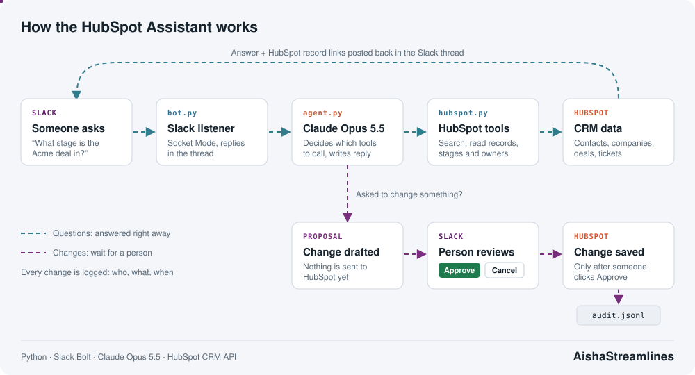

# HubSpot Assistant for Slack

## The problem

Sales teams talk in Slack, but their data lives in HubSpot. For SDRs, that gap causes the same issues every week:

- **Updates get forgotten.** A rep finishes a call, means to log it later, and never does.
- **Constant switching.** Every small lookup or edit means opening HubSpot, finding the record, and coming back.
- **Not everyone is comfortable in a CRM.** Reps who are less technical put data in the wrong field or the wrong format.
- **Quick answers are slow.** "Who owns this deal?" should take seconds, not a search through filters.

## The solution

An AI agent that lives in Slack. Mention **@HubSpot Assistant** in any channel, or send it a direct message, and ask in plain English. It reads HubSpot for you and makes changes for you, so nobody has to leave Slack.

> **@HubSpot Assistant** what stage is the Acme deal in and who owns it?
>
> **@HubSpot Assistant** add Jane Doe from Acme as a new contact, jane@acme.com
>
> **@HubSpot Assistant** move the Acme deal to Closed Won and set the amount to 25,000

| Problem | What the assistant does |
|---|---|
| Updates get forgotten | Create a contact or deal, update a field, add a note, or set a task (with due date, owner and priority) the moment you think of it, from the chat you are already in |
| Constant switching | Answers in the Slack thread with links to the records. Follow-up replies in that thread don't need another @mention |
| Not comfortable in a CRM | No fields or filters to learn. It turns plain English into the right HubSpot values, and shows stage and owner names instead of internal IDs |
| Quick answers are slow | Searches contacts, companies, deals and tickets by name, email, domain, owner, stage, date or any other field, and shows linked records (contacts on a deal, notes on a contact). "My deals" works by matching your Slack email to your HubSpot owner |

## What it is allowed to do

The assistant does not get full control of HubSpot. Reading is open, writing is limited on purpose.

| Action | Allowed? |
|---|---|
| Read any contact, company, deal or ticket | Yes |
| Create a record | Contacts and deals only |
| Update a field, add a note, create a task | Yes, on existing records |
| Create companies or tickets | No |
| Delete anything | No |

Every create or update also needs a person to approve it (step 4 below).

## How it works

1. **You ask in Slack.** `bot.py` receives the message over Socket Mode, so the bot needs no public web address.
2. **Claude plans the lookup.** `agent.py` gives Claude a set of HubSpot tools and lets it decide which to call and in what order. For example, it looks up the pipeline stages first, then searches deals with the right stage ID.
3. **HubSpot is read.** `hubspot.py` makes the API calls and retries if HubSpot rate-limits it. The answer is posted in the thread.
4. **Changes wait for a person.** If you asked to create or change something, nothing is sent to HubSpot yet. The bot posts a card showing exactly what will be created or changed, with **Approve** and **Cancel** buttons. HubSpot is only updated when someone clicks Approve.

## Safeguards

On top of the limits and the approval step:

| Risk | How it's handled |
|---|---|
| Duplicate records | Before creating a contact or deal, it searches for an existing one and asks whether to update that instead |
| Wrong person changes data | `ALLOWED_WRITERS` limits who can propose and approve changes (everyone can still read) |
| Double-click applies a change twice | Each approval card works only once |
| No record of who changed what | Every approved, cancelled or failed change is written to `audit.jsonl` |
| AI makes up an answer | The agent only states what HubSpot returned, and says when a filter left records out |
| Runaway loops or cost | Capped at 12 tool rounds per question |

## Files

| File | Purpose |
|---|---|
| `bot.py` | Slack listener, thread replies, Approve/Cancel cards, audit log |
| `agent.py` | Claude instructions, tool definitions, the agent loop |
| `hubspot.py` | All HubSpot API calls |
| `check_setup.py` | Tests every key without changing anything |
| `slack-app-manifest.json` | Creates the Slack app with the right permissions in one paste |
| `run.sh` / `install.sh` | Run in the terminal / run as a background service on macOS |
| `.env.example` | Template for the keys (the real `.env` is never committed) |

## Built with

[Slack Bolt for Python](https://github.com/slackapi/bolt-python) · [Anthropic Python SDK](https://github.com/anthropics/anthropic-sdk-python) (Claude, tool use) · [HubSpot CRM API v3/v4](https://developers.hubspot.com/docs/api/crm/understanding-the-crm)
